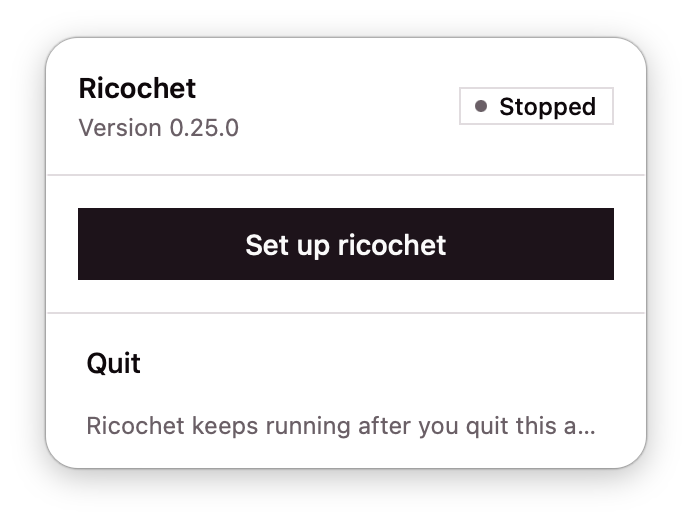
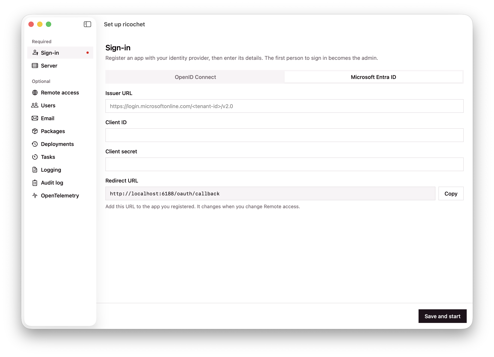

# Ricochet for Mac

Run ricochet on your Mac and deploy your R, Julia, and Python work to it.

## Install

You need an Apple Silicon Mac with macOS 15 or later, and R, Julia, or Python.

1. Download `ricochet-<version>.dmg` from the [latest release](https://github.com/ricochet-rs/macos/releases/latest).
2. Drag **Ricochet** into **Applications** and open it.
3. If macOS blocks it, open **System Settings** > **Privacy & Security** and select **Open Anyway**.
4. Select **Install and start**, then sign in with a ricochet account.

The first person to sign in becomes the admin.

## Use your own identity provider

1. Register an app with your identity provider.
2. Open **Edit configuration** > **Authentication** and select **Configure your own identity provider**.
3. Choose **OpenID Connect** or **Microsoft Entra ID** and enter the **Issuer URL**, **Client ID**, and **Client secret**.
4. Copy the **Redirect URL** into the app you registered, then select **Save and restart**.
5. After signing in, change your role in **Users** > **People**.

You lose access to the accounts you signed in to before.

<picture>
  <source media="(prefers-color-scheme: dark)" srcset="docs/screenshots/sign-in-dark.png">
  
</picture>

## Everyday use

Click the rabbit in your menu bar to open, restart, or update ricochet, or to read its logs.
Ricochet keeps running after you quit the app.

## Your files stay private

Ricochet runs your apps in a sandbox, so they can't read the rest of your home folder or other drives.

## Uninstall

Open **Edit configuration** > **Server** and select **Uninstall ricochet**.
The app moves ricochet and everything you deployed to the Trash, so empty it only when you no longer need them.
