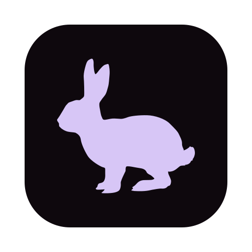

  

<h1 align="center">ricochet native app</h1>

  Install and configure ricochet on macOS, Windows, and Linux.

  <a href="https://github.com/ricochet-rs/app/releases/latest"><strong>Download</strong></a>
  ·
  <a href="https://docs.ricochet.rs">Docs</a>
  ·
  <a href="https://docs.ricochet.rs/latest/admin/pricing/5-community-edition/">Community Edition</a>

---

This repository contains a native app to install and configure ricochet for macOS, Windows, and Linux.
The ricochet native app will get you up and running with the Community Edition in minutes.

## Get started

1. Download the latest release for your platform.
2. Open the app and choose where to install ricochet: this machine or one of your SSH hosts.
3. Choose how people sign in, add a license if you have one, and select **Install and start**.

That's it. ricochet runs in the background, and you can come back to the app any time to change settings, read the logs, or update.

| Platform              | Download                                |
| --------------------- | --------------------------------------- |
| macOS (Apple Silicon) | `ricochet-<version>.dmg`                |
| Windows (x86_64)      | `ricochet-<version>-windows-x86_64.zip` |
| Linux (x86_64)        | `ricochet-<version>-x86_64.AppImage`    |

## Install on a remote host

The ricochet native app can use your existing SSH connections to install ricochet on any of your machines.
Every host from your SSH config shows up in the app, and you can add one with `user@host`.

Each SSH host is expected to be a Linux machine you can reach with key-based SSH access.

## See your content

The **Content** tab shows what is deployed to a ricochet server, right in the app.
It lists every item you can access, with its type, language and deployment history, and lets you run a task now.
Apps and documents still open in your browser.

Switch servers from the menu at the top left.
The server this app manages is always there, and **Add server** adds any other ricochet server by its address.
Select **Sign in with your browser** to sign in the same way the ricochet CLI does, or paste an API key.
Keys from the browser sign-in last eight hours.

## Bring your own languages

The app doesn't install R, Julia, or Python.
On macOS and Windows, install them yourself, along with [juliaup](https://github.com/JuliaLang/juliaup) and [uv](https://docs.astral.sh/uv/).
On Linux, juliaup and uv are vendored in ricochet's `.deb` and `.rpm` installers.

## Authentication

We provide a managed authentication provider that is intended only for local development.
By using it, you agree to our [privacy policy](https://ricochet.rs/legal/privacy/).

Ready for something more permanent? Bring your own identity provider instead.
Head to [docs.ricochet.rs](https://docs.ricochet.rs) to learn how to set it up.

## Community Edition

The Community Edition is designed to empower the community while maintaining a clear boundary with enterprise use.
It comes with a few limits:

- Up to 2 developer users
- Up to 5 git deployments
- No private applications
- No scheduled tasks
- Audit logging is disabled

Read more in the [Community Edition docs](https://docs.ricochet.rs/latest/admin/pricing/5-community-edition/).

Have a license? Add it during setup, or later under **Server**.
